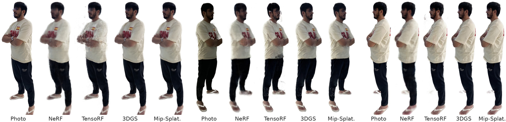
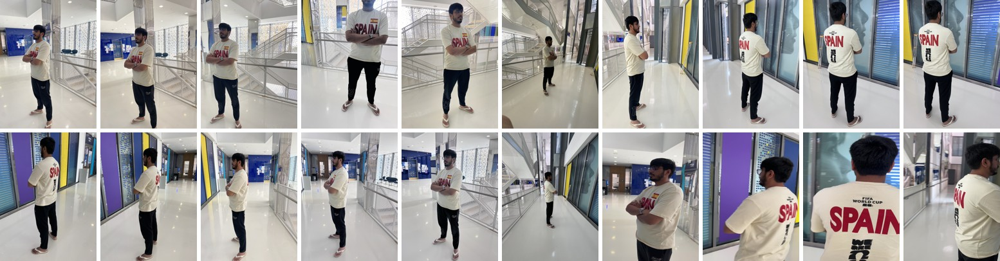
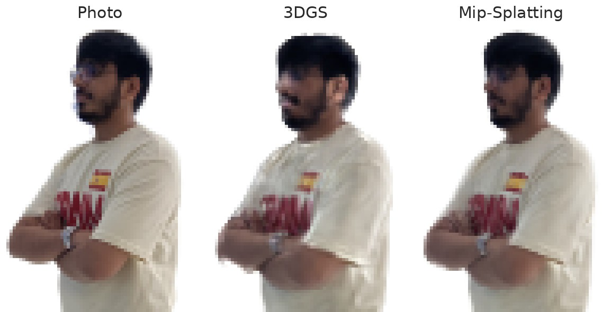
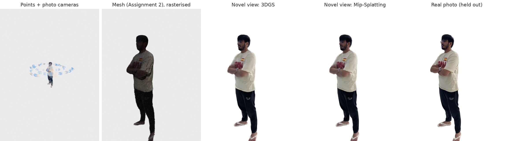

# CV802 Sub-project 3: Novel-View Synthesis of a Person from 125 Photos

Anas Khan · MBZUAI · CV802

The person photographed in Sub-projects 1 and 2 is turned into four 3D scene models that can be rendered from **any
new viewpoint**: **NeRF**, **TensoRF**, **3D Gaussian Splatting (3DGS)** and **Mip-Splatting**, each trained with
its authors' code. A 3DGS model of the whole room is an extra. The results can be explored interactively in the
**course starter GUI**, which this project extends (Open3D, `main.py` + `modules/gui/`). The GUI renders every model
live from the 3D view's camera while you drag, compares a render with the real held-out photo, exports MP4s along a
camera path, and also runs the Sub-project 2 surface reconstruction.


*Three of the 16 held-out photos (never used in training) next to each method's render from the same camera.*

| Deliverable | Where |
|---|---|
| Report (CVPR style: one page + references) | [`report.pdf`](report.pdf) (same as [`docs/report/main.pdf`](docs/report/main.pdf), LaTeX source alongside) |
| Slides | [`slides.pdf`](slides.pdf) (same as [`docs/slides/`](docs/slides/) PDF; the `.pptx` is there too) |
| Result videos along a preset camera path | [`results/videos/`](results/videos/) (one MP4 per method, 8 s orbit) |
| Interactive viewer (starter GUI, extended) | `bash run_gui.sh` → [Interactive viewer](#interactive-viewer-built-on-the-course-starter-gui) |
| Trained models, cameras, held-out photos | [`results/`](results/) |
| All scores (every run, per photo, ablation) | [`results/metrics.json`](results/metrics.json) |
| Training, evaluation, figures, report and slide builders | [`training/`](training/), [`docs/`](docs/) |

**Contents:** [Input and initialisation](#input-and-initialisation) ·
[Methods](#methods) · [Results](#results) · [Interactive viewer](#interactive-viewer-built-on-the-course-starter-gui) ·
[What was added to the starter code](#what-was-added-to-the-starter-code) · [Reproducing the results](#reproducing-the-results) ·
[Repository layout](#repository-layout) · [References](#references)

---

## Input and initialisation



**The input is images only**, as instructed: the 125 photos of one person (four iPhone lenses
plus frames of a video), with the camera poses and intrinsics recovered from them in Sub-project 1. No point
cloud from Sub-project 1 is used to build the models.

- The photos are undistorted with the Sub-project 1 cameras and scaled to 750×1000 px. For the main (person) scene,
  the person masks put the person on a white background. The room scene keeps the full photos.
- **Split:** every 8th photo is held out for testing (16 photos), and the other 109 are used for training. This is
  the `--eval` rule of the 3DGS and Mip-Splatting code.
- **NeRF and TensoRF** need no 3D points. They learn density and colour along the camera rays.
- **3DGS and Mip-Splatting start from dense random points**, as instructed. 100,000 points are drawn
  uniformly at random inside the person's bounding box (300,000 inside the room box for the room scene), all grey
  ([`training/make_random_init.py`](training/make_random_init.py)). This is also the 3DGS authors' setting for
  their synthetic scenes. During training, densification grows them to 149k (3DGS), 197k (Mip-Splatting) and
  910k (room) Gaussians.
- **Ablation:** the same Gaussian runs started from the Sub-project 1 point cloud instead. They are scored
  [below](#ablation-random-start-vs-point-cloud-start), but none of them is a submitted result.

## Methods

All four methods are trained with their authors' code, cloned and pinned by
[`training/setup_envs.sh`](training/setup_envs.sh). The official code is not modified; the only addition is a data
loader for TensoRF, because each of our photos has its own intrinsics. 3DGS, Mip-Splatting and TensoRF train for
30k iterations, and the person models use a white background.

| Method | Paper | Code (commit) | How a pixel is rendered |
|---|---|---|---|
| NeRF | Mildenhall et al., ECCV 2020 | [nerf-pytorch](https://github.com/yenchenlin/nerf-pytorch) (`63a5a63`), the PyTorch port of the original | an 8×256 MLP is queried at 64 + 128 points along the ray; colours are blended by volume rendering |
| TensoRF | Chen et al., ECCV 2022 | [TensoRF](https://github.com/apchenstu/TensoRF) (`6a1e23b`) | the same volume rendering, but density and colour features come from a 3D grid factorised into planes × lines (VM), read by a small MLP |
| 3DGS | Kerbl et al., ACM TOG (SIGGRAPH) 2023 | [gaussian-splatting](https://github.com/graphdeco-inria/gaussian-splatting) (`54c035f`) | coloured 3D Gaussians are projected to 2D (Σ′ = J W Σ Wᵀ Jᵀ, EWA splatting), sorted by depth and alpha-blended |
| Mip-Splatting | Yu et al., CVPR 2024 | [mip-splatting](https://github.com/autonomousvision/mip-splatting) (`dda02ab`) | 3DGS plus a 3D smoothing filter (no Gaussian finer than the photos can resolve) and a 2D Mip filter (anti-aliasing at any zoom) |

NeRF trains for a fixed one hour (43,760 steps; the paper uses 200k+), with nerf-pytorch's Blender settings
([`training/train_nerf.py`](training/train_nerf.py) builds rays per photo, because the photos come from four lenses).

## Results

Scores on the 16 held-out photos (750×1000). The best value in each column is in bold. Training times are wall-clock
on one RTX 5000 Ada (32 GB), with some runs sharing the GPU. Rendering speed is for the official renderers on the
same GPU.

| Method | PSNR ↑ | SSIM ↑ | LPIPS ↓ | Training | Rendering | Model (official file) |
|---|---|---|---|---|---|---|
| NeRF | 26.59 | 0.931 | 0.132 | 60 min | 0.04 img/s | 1.2 M network weights (13.7 MB) |
| TensoRF | 26.35 | 0.938 | 0.130 | 42 min | 0.98 img/s | 17.4 M grid and network values (66.9 MB) |
| 3DGS | 26.63 | 0.951 | 0.072 | **16 min** | 373 img/s | 149k Gaussians (35.3 MB) |
| **Mip-Splatting** | **27.62** | **0.958** | **0.067** | 31 min | **569 img/s** | 197k Gaussians (47.3 MB) |
| *Extra: 3DGS, whole room* | *17.96* | *0.671* | *0.441* | *35 min* | *125 img/s* | *910k Gaussians (215 MB)* |

- **Mip-Splatting is the most faithful** on all three metrics and renders the fastest.
- **Gaussians against ray marching.** Both Gaussian methods are much sharper than NeRF and TensoRF (LPIPS about
  0.07 against 0.13) and render hundreds of images per second, while NeRF and TensoRF need about a second or more
  per image. In PSNR, 3DGS only ties NeRF and TensoRF, because PSNR forgives blur.
- **NeRF** is the blurriest: it had one hour of training (a fifth of the paper's step count).
- **TensoRF** shows floaters around the person.
- **The room is hard.** Every photo looks at the person, so walls and ceiling are seen from few directions and only
  far away, and away from the photo cameras the room breaks up into streaks
  ([video](results/videos/3dgs_full.mp4)).

### Zoom test: rendering at other sizes

Mip-Splatting's paper claims that 3DGS aliases when rendered at a size it was not trained at. Both models are
rendered from the held-out cameras at ¼ of the training size (compared with the photo averaged down) and at 1.6×
(compared with the original 1600 px photo):

| PSNR / LPIPS | ¼ size (zoom out) | 1× (training size) | 1.6× (zoom in) |
|---|---|---|---|
| 3DGS | 23.71 / 0.055 | 26.63 / 0.072 | 26.29 / 0.090 |
| Mip-Splatting | **28.63 / 0.028** | **27.62 / 0.067** | **27.37 / 0.084** |



At ¼ size, 3DGS's Gaussians become much thinner than a pixel. Its fixed screen-space dilation then draws them too
thick and too bright, and it loses about 3 dB. Mip-Splatting's 2D filter matches one pixel's footprint at any size,
so it keeps its quality.

### Ablation: random start vs point-cloud start

| PSNR / SSIM / LPIPS | 3DGS | Mip-Splatting | Room |
|---|---|---|---|
| Dense random points (submitted) | 26.63 / 0.951 / 0.072 | 27.62 / 0.958 / 0.067 | 17.96 / 0.671 / 0.441 |
| Sub-project 1 point cloud (ablation only) | 27.53 / 0.956 / 0.064 | 27.53 / 0.957 / 0.064 | 19.71 / 0.716 / 0.377 |

The random start works: every Gaussian model learns the person from images alone. On this data, the point-cloud
start gives 3DGS +0.9 dB and the room +1.8 dB, the room being where the photos constrain the geometry least.
Mip-Splatting scores the same either way.

### Videos

The preset path is an 8-second orbit around the person (240 frames, [`results/orbit_path.json`](results/orbit_path.json)).
The GUI can export any model along this path or along your own keyframes.

| [NeRF](results/videos/nerf.mp4) | [TensoRF](results/videos/tensorf.mp4) | [3DGS](results/videos/3dgs.mp4) | [Mip-Splatting](results/videos/mip.mp4) | [Whole room (3DGS)](results/videos/3dgs_full.mp4) |
|---|---|---|---|---|

The NeRF video is rendered at half resolution (360×480), because NeRF renders slowly.

## Interactive viewer (built on the course starter GUI)



**Run it (macOS on Apple silicon, Linux; no CUDA needed):**

```bash
git clone https://github.com/anas2908/cv802_assignment_3.git   # or unzip the downloaded ZIP
cd cv802_assignment_3                                           # (the ZIP unpacks to cv802_assignment_3-main)
bash run_gui.sh
```

[`run_gui.sh`](run_gui.sh) creates a `.venv` on first use, installs [`requirements.txt`](requirements.txt) and opens
the trained results (`python main.py results`). It needs Python 3.10–3.12; on a Mac without it, run
`brew install python@3.11`. The renderers run on the Apple GPU (PyTorch MPS), on an NVIDIA GPU, or on the CPU.

On Windows the steps are the same in PowerShell (not tested):
`py -3.11 -m venv .venv`, then `.venv\Scripts\python -m pip install -r requirements.txt`, then
`.venv\Scripts\python main.py results`.

**In the window** (panel on the right):

- **Novel-view synthesis**
  - *Method*: NeRF, TensoRF, 3D Gaussian Splatting, Mip-Splatting, or 3DGS of the whole room.
  - *Live novel view*: drag to turn, right-drag to pan, scroll to zoom, and the novel view follows the 3D view's
    camera. While you move, a small preview is drawn (*Moving* slider); when the mouse stops, the full image is
    drawn (*Still* slider). The Gaussian methods are interactive. NeRF and TensoRF are slow on a laptop.
  - *Held-out photos*: jump to one of the 16 test cameras, and use *Show the real photo* to compare.
  - *Add keyframe* / *Clear*, *Path* (the preset orbit or your keyframes, interpolated with Catmull-Rom and slerp),
    *Seconds*, and **Export MP4…**.
- **Meshes (Sub-project 2)**
  - **Extract mesh** runs our own Screened Poisson implementation from Sub-project 2
    ([`modules/surface/`](modules/surface/)) on the open point cloud: a 128³ grid in about 10 s on a laptop CPU, or 256³.
  - **Save mesh…** writes the result as `.ply`/`.obj`.
  - The textured Sub-project 2 meshes (Screened Poisson and NKSR) are in the list too.
  - All meshes are rasterised by Open3D in the same 3D view. *File › Open mesh…* opens any `.obj`, `.ply` or `.glb`.
- The Sub-project 1 panels (COLMAP / SfM, cameras, point size, …) are unchanged.

`python main.py <folder>` also opens a COLMAP result (Sub-project 1), and `python main.py <mesh>` opens a mesh.

**How a laptop renders the trained models.** The official 3DGS and Mip-Splatting rasterisers are CUDA-only.
[`modules/nvs/`](modules/nvs/) repeats the official forward passes in plain PyTorch, for inference only (nothing is
trained there):

- [`gaussians.py`](modules/nvs/gaussians.py): EWA projection, spherical-harmonics colour, 16×16 tiles, depth sort,
  front-to-back blending with the same thresholds, and Mip-Splatting's 3D and 2D filters.
- [`tensorf.py`](modules/nvs/tensorf.py): the VM planes and lines, the occupancy mask and the ray marching.
- [`nerf.py`](modules/nvs/nerf.py): nerf-pytorch's network, encoding and hierarchical sampling.

On the held-out photos they reproduce the official renders: 3DGS 105 dB and Mip-Splatting 103 dB mean PSNR between
the two renderers, so the images are identical up to rounding (`training/eval_gs.py --check-ours`).

**Model files.** To keep the repository and its ZIP under 100 MB, the models in `results/models/` are packed
([`modules/nvs/packing.py`](modules/nvs/packing.py), written by [`training/export_bundle.py`](training/export_bundle.py)).
Every packed model is re-rendered and compared with the official renders:

| Model | File | Packing | PSNR vs official render |
|---|---|---|---|
| NeRF | 4.4 MB | float32 weights, unchanged | 103–107 dB (identical) |
| 3DGS | 9.6 MB | higher SH bands 8-bit; drops the 3.5k Gaussians with opacity < 1/255, which the rasteriser never draws | 63–67 dB (identical) |
| Mip-Splatting | 12.5 MB | the same (9.3k Gaussians dropped) | 63–67 dB (identical) |
| TensoRF | 6.2 MB | density and appearance planes 8-bit per channel | 57–63 dB (identical 8-bit images) |
| Room (extra) | 25.0 MB | colour up to SH degree 1 only (the trained model has degree 3), 16-bit positions, 8-bit rotations | 25–26 dB (view-dependent shading flatter) |

All scores above come from the official models and renderers, not from the packed copies.

## What was added to the starter code

The project starts from the course starter code
([mbzuai-metaverse/CV802-starter-code](https://github.com/mbzuai-metaverse/CV802-starter-code), `assignment1/`). Its
structure is kept, and the Sub-project 1 and 2 work lives in the same application:

| Path | Origin | Change in this project |
|---|---|---|
| `main.py` | starter code | also opens a novel-view results folder or a mesh (+17 / −5 lines) |
| `modules/gui/gui.py` | starter code (as completed in Sub-project 1) | **novel-view panel and mesh panel added** (+487 lines, nothing removed) |
| `modules/gui/settings.py`, `utils/geometry_utils.py` | starter code | unchanged |
| `modules/colmap/api.py`, `utils/thread_utils.py` | starter code, completed in Sub-project 1 (SfM) | unchanged |
| `modules/colmap/model_io.py`, `tests/test_colmap_api.py`, `tests/test_model_io.py`, `tests/test_e10_checkpoint.py`, `tests/test_paste_copy.py` | Sub-project 1 | unchanged |
| `modules/surface/` | Sub-project 2 (own Screened Poisson: normals, CG solver, marching tetrahedra) | now runs from the GUI (*Extract mesh*) |
| `modules/nvs/` | **new** | cameras and camera paths, PyTorch renderers for the trained models, results-folder session, model packing |
| `training/`, `docs/`, `results/`, `tests/test_nvs.py`, `run_gui.sh`, `requirements.txt` | **new / extended** | data preparation, training with the official code, evaluation, export; report and slides; trained results; tests |

## Reproducing the results

Training ran on a Slurm cluster with one NVIDIA RTX 5000 Ada (32 GB). Paths are set in
[`training/env.sh`](training/env.sh): `CV802_SP3_ROOT` is the working folder, by default `/l/users/$USER/cv802_sp3`.

1. **Environments and official code:** `bash training/setup_envs.sh`. This clones the four repositories at the commits
   above and builds two `uv` environments (Python 3.10, PyTorch 2.1, CUDA 12.1). The `gs` environment holds the 3DGS
   rasteriser and also runs TensoRF and NeRF. The `mip` environment holds Mip-Splatting's rasteriser.
2. **Data:**
   - The photos are `datasets/light_shirt/images` in the
     [Sub-project 1 repository](https://github.com/anas2908/cv802_ass1), with the cameras of Sub-project 1.
   - Sub-project 2's `surface/methods/twodgs/prep.py`
     ([repository](https://github.com/anas2908/cv802_assignment_2)) undistorts them and applies the person masks.
   - Then:
     ```bash
     python training/prep_scenes.py --src <that prepared scene> --out $DATA   # person + room scenes, cameras, split (needs pycolmap)
     python training/make_random_init.py $DATA                                # *_rand scenes: dense random starting points
     python training/make_path.py $DATA $DATA/orbit_path.json                  # the preset orbit of the result videos
     ```
3. **Training** (each line is one run; logs go to `$SP3/logs`, and `training/dashboard.py` shows progress in tmux):
   ```bash
   bash training/train.sh tr_3dgs  3dgs    person_rand     # submitted results: random start
   bash training/train.sh tr_mip   mip     person_rand
   bash training/train.sh tr_room  3dgs    full_rand
   bash training/train.sh tr_tf    tensorf person
   bash training/train.sh tr_nerf  nerf    person --minutes 60
   bash training/train.sh ab_3dgs  3dgs    person          # ablation: start from the Sub-project 1 point cloud
   bash training/train.sh ab_mip   mip     person
   bash training/train.sh ab_room  3dgs    full
   ```
4. **Evaluation, videos, export, figures, report, slides and tests:** `bash training/finalize.sh`. It scores every
   model on the held-out photos (PSNR, SSIM, LPIPS-VGG), runs the zoom test and the renderer check, renders the orbit
   videos, writes `results/` (`training/export_bundle.py`), and rebuilds the figures, the report and a draft of the
   slides (the submitted deck was finished by hand from that draft).

**Tests** (no GPU needed): `python tests/test_nvs.py`. This renders every model on the CPU, checks the GUI's
conversion of the Open3D view camera to an OpenCV camera (headless Open3D), and runs the Poisson mesh extraction.
The Sub-project 1 tests are in `tests/` too.

## Repository layout

```text
main.py, modules/gui/      course starter GUI (Sub-project 1) + novel-view panel and mesh panel
modules/colmap/            Sub-project 1: SfM (COLMAP / pycolmap), unchanged
modules/surface/           Sub-project 2: own Screened Poisson (normals, CG solver on GPU/CPU, marching tetrahedra)
modules/nvs/               Sub-project 3: cameras and paths, PyTorch renderers (Gaussians, TensoRF, NeRF), session, packing
training/                  data preparation, random initialisation, training with the official code, evaluation, export
results/                   models/ (5 trained models), videos/, photos/ (16 held-out), meshes/ (Sub-project 2),
                           scene.json (cameras, split), metrics.json (all scores), points.ply, orbit_path.json
docs/                      report/ (LaTeX + PDF), slides/ (PDF + PPTX + builder), figs/ and the figure scripts
tests/                     Sub-project 1 SfM tests, Sub-project 3 renderer / camera / mesh tests
```

## References

1. B. Mildenhall, P. P. Srinivasan, M. Tancik, J. T. Barron, R. Ramamoorthi, R. Ng. *NeRF: Representing Scenes as
   Neural Radiance Fields for View Synthesis.* ECCV 2020. Code used: L. Yen-Chen, *nerf-pytorch*, 2020.
2. A. Chen, Z. Xu, A. Geiger, J. Yu, H. Su. *TensoRF: Tensorial Radiance Fields.* ECCV 2022.
3. B. Kerbl, G. Kopanas, T. Leimkühler, G. Drettakis. *3D Gaussian Splatting for Real-Time Radiance Field
   Rendering.* ACM Transactions on Graphics (SIGGRAPH) 2023.
4. Z. Yu, A. Chen, B. Huang, T. Sattler, A. Geiger. *Mip-Splatting: Alias-free 3D Gaussian Splatting.* CVPR 2024.
5. M. Zwicker, H. Pfister, J. van Baar, M. Gross. *EWA Volume Splatting.* IEEE Visualization 2001.
6. M. Kazhdan, H. Hoppe. *Screened Poisson Surface Reconstruction.* ACM Transactions on Graphics 2013.
7. Z. Wang, A. C. Bovik, H. R. Sheikh, E. P. Simoncelli. *Image Quality Assessment: From Error Visibility to
   Structural Similarity.* IEEE Transactions on Image Processing 2004.
8. R. Zhang, P. Isola, A. A. Efros, E. Shechtman, O. Wang. *The Unreasonable Effectiveness of Deep Features as a
   Perceptual Metric.* CVPR 2018.
9. Q.-Y. Zhou, J. Park, V. Koltun. *Open3D: A Modern Library for 3D Data Processing.* arXiv 2018.
10. M. Tancik et al. *Nerfstudio: A Modular Framework for Neural Radiance Field Development.* SIGGRAPH 2023.

**Acknowledgements.** The GUI is the CV802 course starter code. Training uses the official implementations listed
under [Methods](#methods), which are cloned at run time and not included here, so their licences apply to them.
